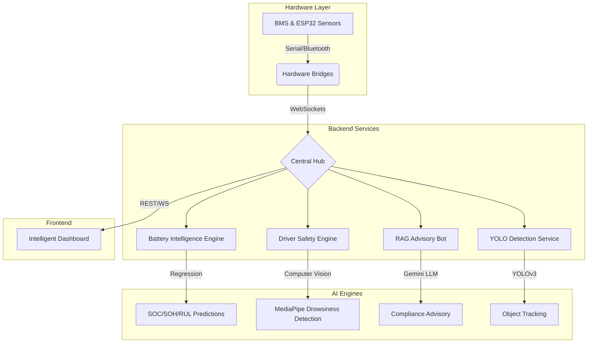

# EV-Bharat

[](https://www.python.org/)
[](https://www.typescriptlang.org/)
[](https://fastapi.tiangolo.com/)
[](LICENSE)

EV-Bharat is a state-of-the-art, AI-integrated platform engineered to streamline Electric Vehicle (EV) adoption and management in the Indian market. It bridges the gap between low-level vehicle hardware (ESP32/BMS) and high-level predictive intelligence.

---

## 🏗️ System Architecture



---

## 🌐 Network & Service Map

EV-Bharat runs as a microservice ecosystem. Below is the internal port mapping:

| Service | Port | Primary Purpose | Check URL |
| :--- | :--- | :--- | :--- |
| **Frontend (Vite)** | `5173` | Core UI & Analytics Dashboard | `http://localhost:5173` |
| **Node Backend API** | `3001` | User Auth, Profiles, App Data | `http://localhost:3001/api/health` |
| **RAG Backend** | `8001` | Indian EV Compliance Chatbot | `http://localhost:8001/health` |
| **ESP32 Bridge** | `8002` | Bluetooth/Serial over WebSocket | `http://localhost:8002/status` |
| **ML Backend** | `8000` | Battery Analytics + Drowsiness | `http://localhost:8000/health` |
| **YOLO Service** | `8010` | Real-time Object Detection | `http://localhost:8010/health` |

---

## 🧠 Machine Learning Model Stack

### **1. Battery Analytics (Regression)**
*   **Purpose:** Predicts SOC (92%), SOH (90%), and RUL (85%).
*   **Models:** RandomForestRegressor, GradientBoostingRegressor.
*   **Key Files:** `SOC_model.pkl`, `SOH_model.pkl`, `RUL_model.pkl`.
*   **Path:** `backend/ML/battery_models/`

### **2. Driver Drowsiness (Vision)**
*   **Purpose:** Safety monitoring using EAR (Eye Aspect Ratio) and PERCLOS.
*   **Models:** MediaPipe FaceMesh + `drowsiness_model.h5` (Keras).
*   **Path:** `backend/ML/drowziness/`

### **3. Object Detection (YOLOv3)**
*   **Purpose:** Real-time stream analysis from vehicle cameras (ESP32-CAM).
*   **Files:** `yolov3.cfg`, `yolov3.weights`, `coco.names`.
*   **Path:** `camera_service/`

### **4. RAG Compliance Bot (NLP)**
*   **Architecture:** Retrieval-Augmented Generation.
*   **Components:** FAISS Vector Store + Google Gemini 1.5 Flash/Pro.
*   **Path:** `backend/EVBharatBot/`

---

## 🔧 Installation & Startup

### **I. Prerequisites**
```bash
# Ubuntu/Debian System Dependencies
sudo apt-get install -y libbluetooth-dev python3-dev libgl1 libglib2.0-0 tesseract-ocr poppler-utils
```

### **II. Installation**
```bash
# 1. Install Node Dependencies
npm install && cd backend && npm install

# 2. Install Python Dependencies
pip install -r backend/requirements_bluetooth.txt
pip install -r backend/ML/requirements.txt
pip install -r backend/EVBharatBot/requirements.txt
```

### **III. Startup (Multi-Terminal)**
*   **Terminal A (Frontend):** `npm run dev`
*   **Terminal B (Node API):** `cd backend && npm run dev`
*   **Terminal C (RAG Bot):** `cd backend/EVBharatBot && ./start_rag_backend.sh`
*   **Terminal D (ML Engine):** `cd backend && python run_ml_backend.py`
*   **Terminal E (Bridge):** `cd backend && ./start_bluetooth_bridge.sh`

---

## 🛠️ Troubleshooting & Fixes

| Issue | Cause | Fix |
| :--- | :--- | :--- |
| **Address already in use** | Port conflict (usually 8000) | `lsof -i :8000` -> Kill PID or run YOLO on `8010`. |
| **Bluetooth Bridge fails** | Missing `pybluez` or system libs | `sudo apt-get install libbluetooth-dev` |
| **Login fails** | Node backend (3001) is offline | Start backend service in `backend/` folder. |
| **RAG fails** | Missing `GOOGLE_API_KEY` | Add key to `.env` in `backend/EVBharatBot/`. |
| **Camera unavailable** | No webcam access | Check permissions or use `v4l2-ctl` to verify `/dev/video0`. |

---

## 📊 Evaluation Summary
*   **Unified Ecosystem:** Seamlessly combines Hardware, AI, and Policy Advisory.
*   **Edge Ready:** Optimized Python bridges for low-power ESP32 hardware.
*   **Intelligent Proxy:** Vite dev server routes `/api`, `/api/rag`, and `/api/battery` to correct microservices automatically.
*   **Robustness:** Integrated fallback to `Local Hash Embeddings` ensures the chatbot works even without a cloud connection.

---

**© 2026 EV-Bharat Team** | *Advancing Indian Electric Mobility through AI-Driven Excellence.*
